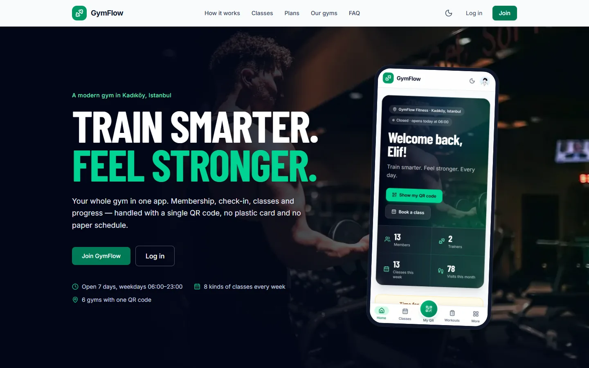
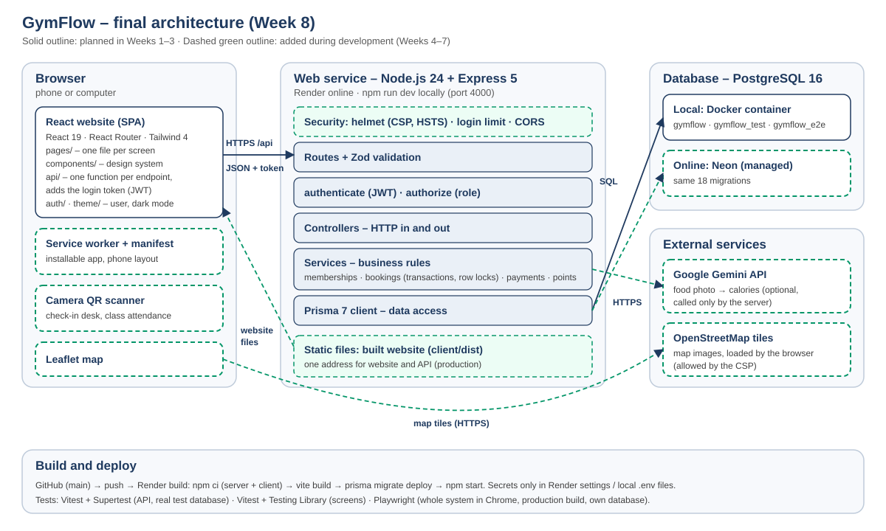
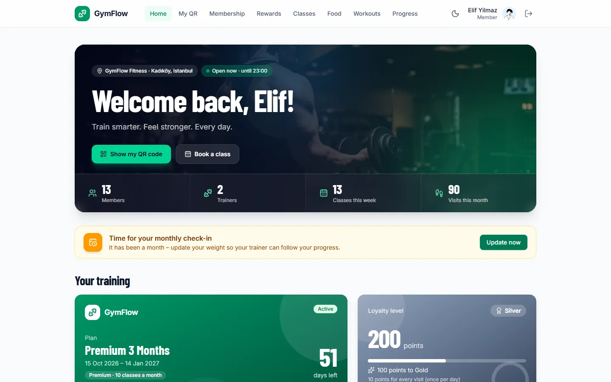
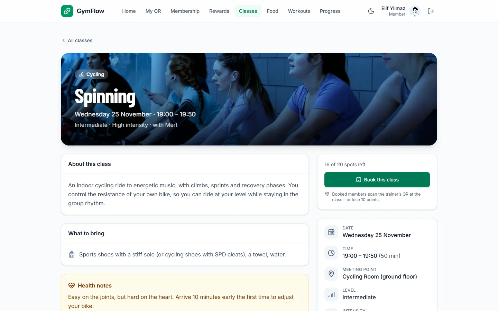
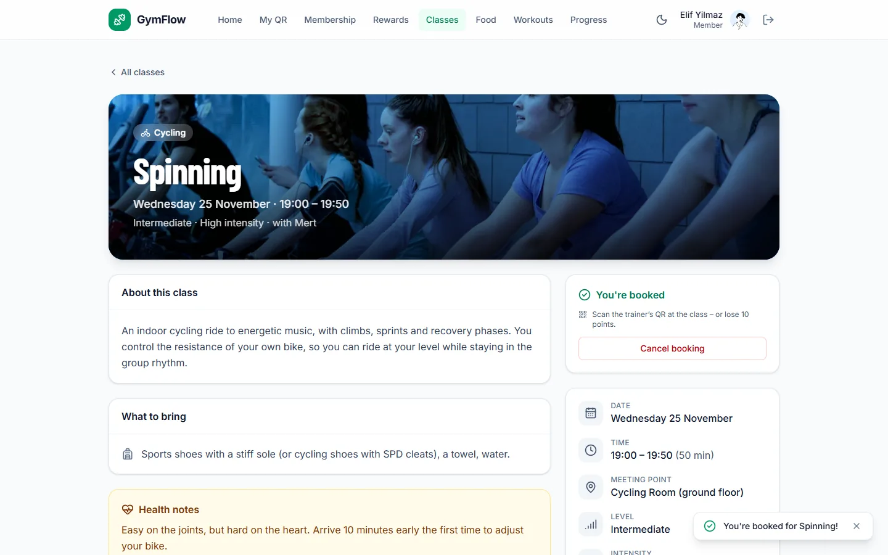
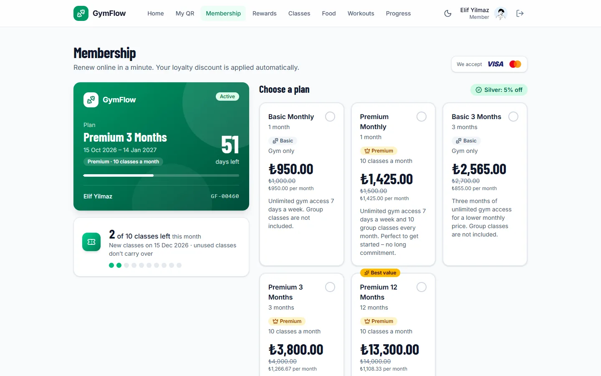
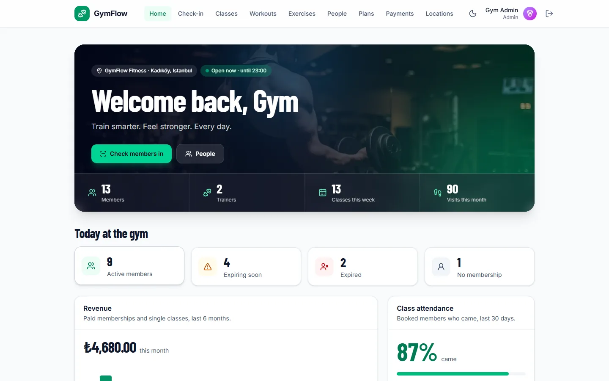
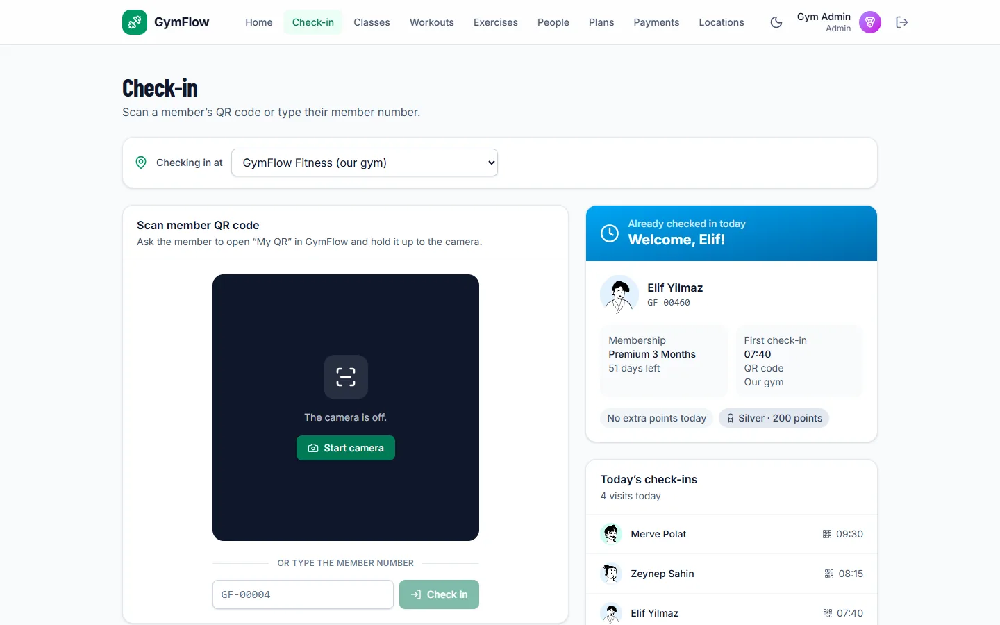
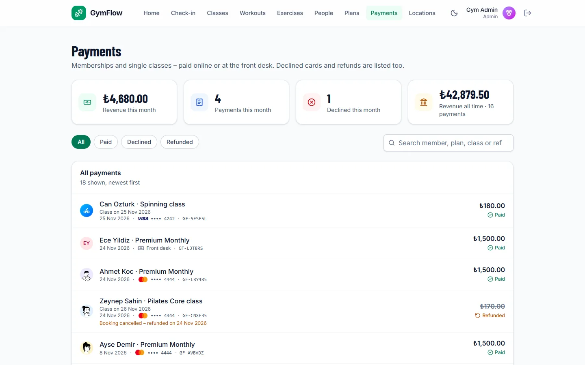
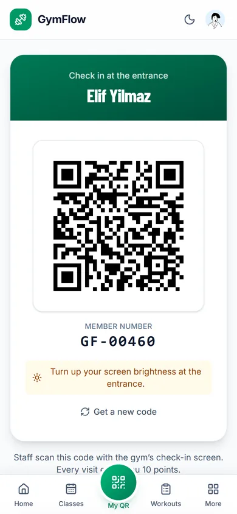

# GymFlow

A web-based gym membership, class management and workout tracking system – one app for the front desk, the trainers and the members.

> Graduation project – Software Engineering, Altınbaş University, 2026–2027.
> **Live demo:** <https://gymflow-bw46.onrender.com> (free hosting: the first page can take up to a minute to wake up). Demo accounts are under [Usage](#usage).



## Project Overview

GymFlow runs a gym from one web application. The front desk sells memberships and checks members in with a QR code; trainers create classes, take attendance and write workout plans; members book classes, pay by card, collect loyalty points and follow their progress on their phone. It is a full-stack JavaScript application: a React website, an Express REST API with the business rules, and a PostgreSQL database – tested with 732 automated tests and running online.

## Problem

Many small and medium gyms still manage members with paper cards, spreadsheets and messaging apps. Staff cannot see at a glance whose membership is expiring, members do not know whether a class still has a free spot, trainers hand out workout plans on paper, and nobody can see a member's progress over time.

## Objectives

- The gym sells memberships – at the desk or online – and always knows who is allowed to train.
- Members check in with a QR code, book classes and follow workout plans on their phone.
- Trainers manage their own classes, take attendance and write plans for members.
- Everybody sees clear information: membership status, classes left, points and progress.
- The rules that matter (no double booking, no overlapping memberships, no double charge) are enforced by the server and the database, not only by the screen.

## Main Features

| Area | What exists |
| --- | --- |
| Accounts and roles | Sign-up and login; three roles (Admin, Trainer, Member) checked on the server for every request; profile with picture and member number |
| Memberships | Plans (Basic = gym only, Premium = gym + 10 classes a month), automatic start and end dates, renewal, status (active, expiring soon, expired, upcoming) |
| Payments | Card checkout for memberships and single classes through a built-in **test** gateway (no real money), front-desk sales, receipts, refunds on cancelled classes, payments overview |
| Check-in and loyalty | QR code on the member's phone, scanned at the desk by camera or typed member number; +10 points per visit; Silver, Gold and Platinum levels with 5–15% off the next membership |
| Classes | Schedule for two weeks, booking with capacity and membership checks, monthly allowance for Premium, pay per class, attendance by a changing QR code, no-show penalty |
| Training and health | Exercise library with animated demos, trainer-written workout plans, workout logging, progress charts, monthly body check-ins, AI food photo scanner (Google Gemini) |
| Network | Partner gyms on a map; Premium members train at all of them with the same QR code |
| Administration | Dashboard with members, revenue per month and class attendance; people, plans, payments and locations |
| Website | Public front page, phone layout with a bottom tab bar, installable as an app (PWA), dark mode, keyboard and screen-reader friendly |

What each role can do:

| Role | How the account is created | What they can do |
| --- | --- | --- |
| **Member** | Public sign-up, or created by an Admin | Buy or renew a membership, show the QR code at the desk, book and pay for classes, scan the class attendance QR, see points and level, log workouts and body check-ins, scan food photos, see progress and partner gyms |
| **Trainer** | Created by an Admin | Create, edit and cancel their own classes, take attendance, check members in, write workout plans, follow members' progress |
| **Admin** | Seed script from `SEED_ADMIN_*` in `.env` | Everything: dashboard, plans, people, memberships, payments, all classes, partner gyms, check-in desk |

All rules (membership dates, booking, payments, points) are listed in [docs/business-rules.md](docs/business-rules.md).

## Architecture



A member's action in the **React website** becomes an HTTP request to `/api/...` with a login token (JWT). In the **Express server** every request passes the same layers: security headers and login limit → route with **Zod** validation → `authenticate` (valid token?) and `authorize` (allowed role?) → controller → **service**, where the business rules live → **Prisma** → **PostgreSQL**. Rules that must never break – one booking per member and class, no booking beyond capacity, no overlapping memberships – run inside database transactions with row locks and are also protected by database constraints. Online, the same server also sends the built website, so the browser talks to one address.

The diagram marks what was added after the original design (dashed green); the changes and the reasons are explained in [docs/diagrams/architecture.md](docs/diagrams/architecture.md). The database design: [ER diagram](docs/diagrams/er-diagram.md) (15 tables).

## Technology Stack

| Layer | Technology (tested version) | What it is used for in GymFlow |
| --- | --- | --- |
| Website | React 19.3, React Router 8.4, Vite 8.3, Tailwind CSS 4.3 | 26 pages for visitors and three roles, loaded on demand; one design system of components; light and dark mode |
| Animation and 3D | motion 13.5, three.js 0.186 | Page transitions that respect "reduce motion"; animated exercise demos and the 3D dumbbell on the login page |
| Maps and QR | Leaflet 1.9, qrcode.react, zxing-wasm | Partner-gym map; member QR codes; camera scanning at the check-in desk |
| API | Node.js 24, Express 5.3, Zod 4.6 | REST API with 61 endpoints; every request body validated |
| Security | bcryptjs, jsonwebtoken, helmet 8.3, express-rate-limit 8.7 | Password hashes, login tokens, Content Security Policy, 10 failed logins per 15 minutes |
| Database | PostgreSQL 16, Prisma 7.10 | 15 tables, 18 migrations, constraints and transactions with row locks |
| AI | Google Gemini (`@google/genai`) | Estimating calories, protein, carbs and fat from a meal photo, with a 30-second time budget |
| Tests | Vitest 5, Supertest, Testing Library, Playwright 1.64 | API tests against a real database, screen tests, end-to-end tests in Chrome |
| Hosting | Docker Compose (local), Render + Neon (online) | Local database in one command; one web service and a managed database online |

Exact versions of every package are fixed in the `package-lock.json` files.

## Installation

**Prerequisites**

- [Git](https://git-scm.com/)
- [Node.js](https://nodejs.org/) **24** (the version the online server uses; npm comes with it)
- [Docker Desktop](https://www.docker.com/products/docker-desktop/) – on Windows it needs **WSL 2**. If `wsl --install` fails, install the `.msi` from [github.com/microsoft/WSL/releases](https://github.com/microsoft/WSL/releases).
- [Google Chrome](https://www.google.com/chrome/) – only for the end-to-end tests

**Get the code and install the packages**

```bash
git clone https://github.com/Yousifqayssar/gymflow.git
cd gymflow
cd server
npm install              # also generates the Prisma client
cd ../client
npm install
cd ..
```

The commands work in PowerShell (Windows) and in bash (macOS, Linux). Each block is run from the project folder unless it starts with `cd`.

## Configuration

Three settings files are needed. Copy the examples and fill in the values:

```bash
cp .env.example .env                             # database settings for Docker
cp server/.env.example server/.env               # settings for the API
cp server/.env.test.example server/.env.test     # settings for the automated tests
```

| Setting | File | What to put in |
| --- | --- | --- |
| `POSTGRES_USER`, `POSTGRES_PASSWORD`, `POSTGRES_DB` | `.env` | Your own values; `DATABASE_URL` in both server files must use the same user and password |
| `JWT_SECRET` | `server/.env` | A long random value: `node -e "console.log(require('crypto').randomBytes(48).toString('base64url'))"` |
| `SEED_ADMIN_EMAIL`, `SEED_ADMIN_PASSWORD` | `server/.env` | The first Admin account |
| `GYM_TIMEZONE` | `server/.env` | Default `Europe/Istanbul`: memberships start and end at midnight in this time zone |
| `GEMINI_API_KEY` | `server/.env` | Optional. Without it everything works except the food scanner. Free key: [aistudio.google.com/apikey](https://aistudio.google.com/apikey) |
| `DATABASE_URL` | `server/.env.test` | Same user and password, database name `gymflow_test` |

Port 5432 already taken by another PostgreSQL? Set `POSTGRES_PORT=5433` in `.env` and use `localhost:5433` in both `DATABASE_URL` lines.

> `.env` files contain secrets and are ignored by Git. Only the `.env.example` templates are committed; the whole Git history was checked and contains only placeholders.

## Running the Project

**1. Database** – make sure Docker Desktop is running:

```bash
docker compose up -d
docker compose ps          # gymflow-db should show "healthy"
```

**2. API** – creates the tables and the first Admin account, then starts on port 4000:

```bash
cd server
npx prisma migrate deploy  # creates the database tables (18 migrations)
npm run db:seed            # creates the first Admin account from .env
npm run db:seed:demo       # optional: demo members, trainers, classes, payments …
npm run dev                # http://localhost:4000
```

**3. Website** – in a **second terminal**:

```bash
cd client
npm run dev                # http://localhost:5173
```

**Check that everything works**

| Check | Expected result |
| --- | --- |
| <http://localhost:4000/api/health> | `{"status":"ok","database":"up", …}` |
| `npx prisma migrate deploy` | `All migrations have been successfully applied.` |
| `npm run db:seed:demo` | `Demo data ready: 6 plans, 2 trainers, 12 members, 25 classes, …` |
| <http://localhost:5173> → log in as `elif@demo.gymflow.local` / `demo1234` | "Welcome back, Elif!" with her membership card |

These steps were verified on a fresh clone into an empty folder with an empty database: all steps and all tests passed ([evidence](docs/reports/evidence/week-07-fresh-install.json)).

<details>
<summary><strong>Common problems</strong></summary>

| Problem | Fix |
| --- | --- |
| `docker compose up -d`: "cannot connect to the Docker daemon" | Start Docker Desktop and wait until it says "Engine running" |
| Port 5432 is already in use | Use `POSTGRES_PORT=5433` and port 5433 in both `DATABASE_URL` lines |
| Health check says `"database": "down"` | The database container is not running, or the password in `DATABASE_URL` does not match `.env` |
| The Classes page says there are no classes | Demo classes only cover 14 days: run `npm run db:seed:demo` in `server/` again |
| The dev server stopped after `npx prisma generate` (Windows) | Normal: the new Prisma client replaces files the server was using. Start it again with `npm run dev` |
| Vitest: "failed to find the current suite" | Run the tests from PowerShell instead of Git Bash |
| Food scanner: "The food scanner is not set up yet" | Add a `GEMINI_API_KEY` to `server/.env` and restart the server |

</details>

<details>
<summary><strong>All scripts</strong></summary>

| Folder | Command | What it does |
| --- | --- | --- |
| `server/` | `npm run dev` / `npm start` | Start the API (with / without restart on file changes) |
| `server/` | `npm run db:migrate` | Create and apply a migration after a schema change |
| `server/` | `npm run db:seed` · `npm run db:seed:demo` | First Admin account · demo data (`-- --remove` deletes it) |
| `server/` | `npm run db:studio` | Browse the database in Prisma Studio |
| `client/` | `npm run dev` · `npm run build` · `npm run preview` | Development server · production build into `dist/` · preview it |
| `client/` | `npm run lint` | Check the code with Oxlint |

</details>

<details>
<summary><strong>Deployment (live demo)</strong></summary>

The live demo is **one** Render web service connected to this repository – every push to `main` deploys again – with a Neon PostgreSQL database. Build command `npm run build` (root `package.json`: installs server and website with `npm ci`, builds the website, applies the migrations); start command `npm start`. Settings on Render: `NODE_ENV=production`, `DATABASE_URL`, `JWT_SECRET`, `JWT_EXPIRES_IN`, `GYM_TIMEZONE`, `SEED_ADMIN_EMAIL`, `SEED_ADMIN_PASSWORD`, `GEMINI_API_KEY`. In production the server sends the website from `client/dist`.

</details>

## Running Tests

The database container must be running (`docker compose up -d`).

| Kind | Folder | Command | What it checks |
| --- | --- | --- | --- |
| API tests | `server/` | `npm test` | Every endpoint and business rule, against a real test database – including an automatic check of every endpoint against every role (685 tests, about 5 minutes) |
| Screen tests | `client/` | `npm test` | Components in a simulated browser: booking panel, checkout, check-in (33 tests) |
| End-to-end tests | `e2e/` | `npm install` (first time), then `npm test` | The whole system in Chrome: login, booking, paying for a class, check-in, phone layout, front page (14 tests, about 1 minute) |

The API tests use their own database (`gymflow_test`) and refuse to run on any database whose name does not end in `_test`. The end-to-end tests build the website, fill a third database (`gymflow_e2e`) with fresh demo data and start the server in production mode on port 4300 – just like online. On Windows, run the tests from PowerShell (in Git Bash Vitest can stop with "failed to find the current suite").

Which test proves which requirement: [docs/traceability.md](docs/traceability.md).

## Usage

All demo accounts use the password `demo1234` (after `npm run db:seed:demo`, or on the live demo):

| Account | Role | Good for trying |
| --- | --- | --- |
| `elif@demo.gymflow.local` | Member (Premium) | Home, QR code, classes, rewards, food, workouts, progress |
| `can@demo.gymflow.local` | Member (Basic) | Paying for a single class (the membership ends 3 days after the demo data is loaded) |
| `mert@demo.gymflow.local` | Trainer | Own classes, attendance QR, workout plans |
| the `SEED_ADMIN_EMAIL` account | Admin | Dashboard, people, plans, payments, check-in desk |

**Example workflow – a member books a class and checks in**

1. Log in as **Elif**. The home page shows her membership, points and next class.
2. Open **Classes**, pick a class and tap **Book this class**. The page shows "You're booked", one spot less, and one class less in her monthly allowance. Booking the same class again is refused (409).
3. Open **My QR**: her personal QR code and member number (e.g. `GF-00460`).
4. In another browser, log in as the **Admin** and open **Check-in**. Scan the QR code or type the member number and press **Check in**: GymFlow shows "Welcome, Elif!", her membership and +10 points – or a clear reason why entry is refused (for example an expired membership).
5. To pay for a class, log in as **Can** (Basic) and book a class: the checkout accepts the test card `4242 4242 4242 4242` (any future date, any CVC); `4000 0000 0000 0002` is declined.

The API is documented in [docs/api.md](docs/api.md) (61 endpoints, status codes, error format, test cards).

## Screenshots / Demo

**Live demo:** <https://gymflow-bw46.onrender.com>

| | |
| --- | --- |
|  **Member home** – membership, points and gym numbers |  **A class** before booking: spots left, what to bring, health notes |
|  **After booking** – "You're booked" |  **Buy or renew** with the loyalty discount |
|  **Admin dashboard** – members, revenue, class attendance |  **Check-in desk** – QR camera or member number |
|  **Payments** – paid, declined and refunded |  **On a phone** – the member's QR code |

More phone screens: [home](docs/screenshots/09-phone-home.webp) · [progress](docs/screenshots/11-phone-progress.webp) · [workouts](docs/screenshots/12-phone-workouts.webp).

## Repository Structure

```
gymflow/
├── client/                  # React website (Vite + Tailwind)
│   ├── public/              # service worker, app manifest, icons
│   └── src/
│       ├── api/             # one function per API endpoint (adds the login token)
│       ├── auth/ theme/     # logged-in user; light and dark mode
│       ├── components/      # design system (ui/) and feature components
│       ├── pages/           # one component per screen
│       └── utils/ hooks/    # formatting, gym time zone, data loading
├── server/                  # Express REST API
│   ├── prisma/              # schema, 18 migrations, admin seed, demo data
│   ├── src/
│   │   ├── routes/          # URL → middleware → controller
│   │   ├── validation/      # Zod schemas
│   │   ├── middleware/      # security, authentication, authorization, errors
│   │   ├── controllers/     # HTTP layer
│   │   ├── services/        # business rules and transactions
│   │   └── config/ lib/ utils/
│   └── tests/               # API tests (Vitest + Supertest) and unit tests
├── e2e/                     # end-to-end tests (Playwright)
├── docs/
│   ├── diagrams/            # architecture and ER diagram
│   ├── screenshots/         # final screenshots
│   ├── reports/             # weekly reports, project report, test evidence
│   ├── user-testing/        # user-testing script, peer installation sheet
│   ├── api.md · business-rules.md · traceability.md
│   └── development-log.md   # what was built each week, problems and decisions
├── docker-compose.yml       # local PostgreSQL
└── package.json             # build and start commands for hosting
```

## Known Limitations

- **Payments use a test gateway.** Card checkout works end to end with test cards, but no real money moves: Stripe is not available in Turkey and iyzico declined the project.
- **Food scanner values are estimates** from Google's AI model; their accuracy was not measured. The feature needs a Gemini API key and depends on Google's service being available.
- **Camera scanning is not covered by automated tests** (the tests use a stand-in for the camera), and installing the app on a real phone has not been tested yet.
- **One gym.** GymFlow manages one gym with partner locations; there is no support for several independent gyms.
- **Free hosting.** The live demo sleeps when unused and needs up to a minute to wake up; its demo classes must be refreshed every 14 days.
- **One npm advisory** remains in a build-time tool (inside the Prisma command-line tool); it does not run in the live server and is waiting for a Prisma update.

## Future Improvements

- A real payment provider for Turkey, with recurring monthly payments.
- Email or push reminders before a membership expires or a booked class starts.
- Native installation tests on Android and iOS, and a full automatic accessibility scan.
- Several gyms (branches) with their own staff in one installation.
- Measuring the food scanner against known meals, and showing the uncertainty to the member.

## Authors

**Yousif Al-Samrre** – design, implementation, testing and documentation of the whole system. Graduation project, Software Engineering, Altınbaş University. Supervisor: Dr. F. Kuzey Edes Huyal.

The development history is in [docs/development-log.md](docs/development-log.md); weekly reports are in [docs/reports/](docs/reports/).

## References

- React – <https://react.dev> · Vite – <https://vite.dev> · Tailwind CSS – <https://tailwindcss.com/docs>
- Node.js – <https://nodejs.org/docs/latest-v24.x/api/> · Express – <https://expressjs.com> · Zod – <https://zod.dev>
- Prisma ORM – <https://www.prisma.io/docs> · PostgreSQL 16 – <https://www.postgresql.org/docs/16/>
- Vitest – <https://vitest.dev> · Testing Library – <https://testing-library.com> · Playwright – <https://playwright.dev>
- OWASP Cheat Sheet Series (authentication, passwords, security headers) – <https://cheatsheetseries.owasp.org>
- Web Content Accessibility Guidelines (WCAG) 2.2 – <https://www.w3.org/TR/WCAG22/>
- Google Gemini API – <https://ai.google.dev/gemini-api/docs> · Leaflet – <https://leafletjs.com> · OpenStreetMap tile usage policy – <https://operations.osmfoundation.org/policies/tiles/>
- Render – <https://render.com/docs> · Neon – <https://neon.com/docs> · Docker Compose – <https://docs.docker.com/compose/>

**Photo credits.** The class category photos in `client/src/assets/classes/` are from [Unsplash](https://unsplash.com) under the [Unsplash License](https://unsplash.com/license): running [1739368732843](https://images.unsplash.com/photo-1739368732843-800f36a9b7d0), yoga [1544367567](https://images.unsplash.com/photo-1544367567-0f2fcb009e0b), HIIT [1599058917212](https://images.unsplash.com/photo-1599058917212-d750089bc07e), cycling [1520877880798](https://images.unsplash.com/photo-1520877880798-5ee004e3f11e), pilates [1747238415033](https://images.unsplash.com/photo-1747238415033-b74eec07eb59), boxing [1517438322307](https://images.unsplash.com/photo-1517438322307-e67111335449), strength [1641337221253](https://images.unsplash.com/photo-1641337221253-fdc7237f6b61), mobility [1607914660217](https://images.unsplash.com/photo-1607914660217-754fdd90041d). They are stored in the project, so the app does not depend on an outside website.
