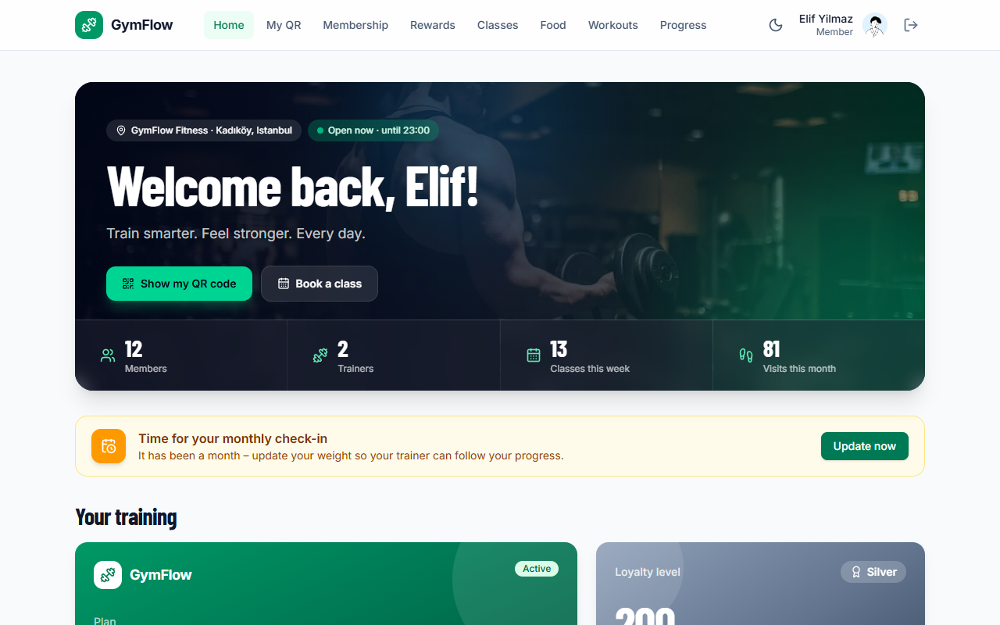
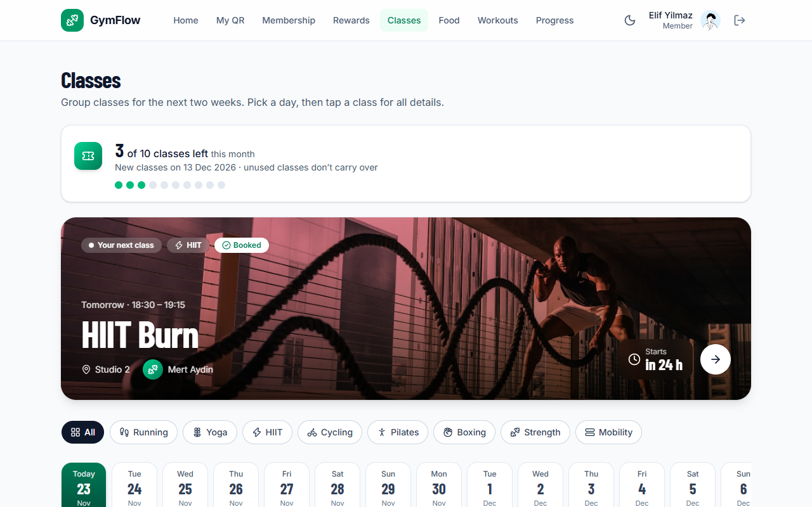

# GymFlow

A web-based gym membership, class management and workout tracking system.

> Graduation project – Software Engineering, Altınbaş University.

## Features

- **Gym management:** login with roles (Admin, Trainer, Member), membership plans (Basic and Premium), membership expiry tracking, QR check-in at the front desk, partner gyms on a map, admin dashboard (revenue, visits, memberships).
- **Classes:** class schedule and booking, monthly class allowance for Premium members, pay per class, attendance by QR code with a no-show penalty.
- **Payments:** card checkout for memberships and classes through a built-in **test** payment gateway (no real money), front-desk sales, payment history and receipts.
- **Loyalty:** +10 points per gym visit, levels Bronze → Silver → Gold → Platinum with membership discounts.
- **Training and health:** exercise library with animated demos, trainer-written workout plans, workout logging, progress charts, monthly body check-ins, AI food photo scanner (Google Gemini).
- **Website:** phone layout with a bottom tab bar, installable as an app (PWA), dark mode, keyboard and screen-reader friendly.

**Live demo:** <https://gymflow-bw46.onrender.com> (free hosting: the first page can take up to a minute to wake up). Demo accounts are listed under [Demo data](#5-optional-demo-data).

## Tech stack

| Layer    | Technology                                           |
| -------- | ---------------------------------------------------- |
| Frontend | React, Vite, Tailwind CSS, React Router, Recharts    |
| Backend  | Node.js, Express (REST API), Zod validation          |
| Database | PostgreSQL, Prisma ORM                               |
| Auth     | JWT, bcrypt                                          |
| Testing  | Vitest, Supertest, Playwright                        |
| Dev      | Docker Compose (PostgreSQL)                          |

## Project structure

```
gymFlow/
├── client/                 # React frontend (Vite + Tailwind)
│   └── src/
│       ├── api/            # functions that call the backend (adds the login token)
│       ├── assets/classes/ # class category photos (Unsplash, see Photo credits)
│       ├── auth/           # AuthProvider + useAuth: who is logged in
│       ├── components/
│       │   ├── ui/         # design system: Button, Card, Modal, Toast, Avatar, …
│       │   └── classes/    # class cards, banners, booking panel, category picker
│       ├── pages/          # one component per page
│       └── utils/          # formatting (prices, dates, gym time zone)
├── server/                 # Express REST API
│   ├── prisma/             # database schema, migrations, admin seed and demo data
│   ├── src/
│   │   ├── config/         # environment variable validation
│   │   ├── routes/         # URL → middleware → controller mapping
│   │   ├── controllers/    # HTTP layer: read request, send response
│   │   ├── services/       # business logic and business rules
│   │   ├── validation/     # Zod schemas for request bodies
│   │   ├── middleware/     # authentication, authorization, validation, errors
│   │   ├── utils/          # password hashing, JWT, AppError
│   │   └── lib/            # shared clients (Prisma)
│   └── tests/              # Vitest + Supertest tests (+ helpers and setup)
├── docs/                   # diagrams, development log, weekly reports
└── docker-compose.yml      # local PostgreSQL database
```

Request flow in the backend: **route → controller → service → Prisma (data access) → PostgreSQL**.

## Getting started

### Prerequisites

- [Git](https://git-scm.com/)
- [Node.js](https://nodejs.org/) **24** (the version the online server uses; npm comes with it)
- [Docker Desktop](https://www.docker.com/products/docker-desktop/)
  - On Windows, Docker Desktop needs **WSL 2**. If `wsl --install` fails, install the `.msi` from [github.com/microsoft/WSL/releases](https://github.com/microsoft/WSL/releases).
- [Google Chrome](https://www.google.com/chrome/) – only for the end-to-end tests

Get the code:

```bash
git clone https://github.com/Yousifqayssar/gymflow.git
cd gymflow
```

The commands below work in PowerShell (Windows) as well as in bash (macOS, Linux). Each block is run from the project folder unless it starts with `cd`.

### 1. Configure environment variables

Three `.env` files are needed. Copy the examples and adjust the values:

```bash
cp .env.example .env                             # database settings for Docker
cp server/.env.example server/.env               # settings for the API
cp server/.env.test.example server/.env.test     # settings for the automated tests
```

- The username, password and database name in `DATABASE_URL` must match the values in the root `.env`.
- Set `JWT_SECRET` in `server/.env` to a long random value:
  `node -e "console.log(require('crypto').randomBytes(48).toString('base64url'))"`
- Choose your own `SEED_ADMIN_EMAIL` and `SEED_ADMIN_PASSWORD` (the first Admin account).
- `GYM_TIMEZONE` (default `Europe/Istanbul`): memberships start and end at midnight in this time zone.
- `GEMINI_API_KEY` is optional. Without it everything works except the food photo scanner. A free key comes from [aistudio.google.com/apikey](https://aistudio.google.com/apikey).
- `server/.env.test` must use the same username and password as `.env`; only the database name differs (`gymflow_test`).
- Port 5432 already taken by another PostgreSQL? Set `POSTGRES_PORT=5433` in `.env` and use `localhost:5433` in both `DATABASE_URL` lines.

> `.env` files contain secrets and are ignored by git. Only the `.env.example` templates are committed.

### 2. Start the database

Make sure Docker Desktop is running, then:

```bash
docker compose up -d
docker compose ps        # gymflow-db should show "healthy"
```

### 3. Run the server (API)

```bash
cd server
npm install              # also generates the Prisma client
npx prisma migrate deploy  # creates the database tables
npm run db:seed          # creates the first Admin account from .env
npm run dev              # http://localhost:4000
```

Check it: <http://localhost:4000/api/health> should return `"status": "ok"` and `"database": "up"`.

### 4. Run the client (website)

In a **second terminal**:

```bash
cd client
npm install
npm run dev              # http://localhost:5173
```

Open <http://localhost:5173>. You are sent to the login page: log in with the seeded admin account, or click **Create an account** to register as a member.

### 5. Optional: demo data

To try the app with realistic data (and for presentations):

```bash
cd server
npm run db:seed:demo              # create or refresh the demo data (dates relative to today)
npm run db:seed:demo -- --remove  # remove all demo data again
```

It creates 6 membership plans, 2 trainers, 12 members in every membership situation (active, expiring soon, expired, upcoming, renewed, no membership), about 25 classes for the next 14 days with bookings, and a history of check-ins, payments, body check-ins and logged workouts, plus 5 partner gyms and 32 exercises. All demo accounts end in `@demo.gymflow.local` and use the password `demo1234`:

| Account | Role | Good for trying |
| --- | --- | --- |
| `elif@demo.gymflow.local` | Member (Premium) | Home, QR code, classes, rewards, food, workouts, progress |
| `mert@demo.gymflow.local` | Trainer | Own classes, attendance QR, workout plans for members |
| the `SEED_ADMIN_EMAIL` account | Admin | Dashboard, people, plans, payments, check-in desk |

Real accounts and data are never touched, and the script refuses to run when `NODE_ENV=production`. Classes are only created for 14 days from the day you run it; if the class list is empty some weeks later, run it again.

### 6. Check that everything works

| Check | Expected |
| --- | --- |
| <http://localhost:4000/api/health> | `"status": "ok"`, `"database": "up"` |
| <http://localhost:5173> → log in as `elif@demo.gymflow.local` / `demo1234` | "Welcome back, Elif!" with her membership card |
| **Classes** page | Classes for the next two weeks |
| `npm test` in `server/`, `client/` and `e2e/` | All tests pass (see [Running tests](#running-tests)) |

## User roles

| Role | How the account is created | What they can do |
| --- | --- | --- |
| **Member** | Public sign-up, or created by an Admin on the People page | Buy or renew a membership by card, show their QR code at the desk, book and pay for classes, scan the class attendance QR, see points and level, log workouts and body check-ins, scan food photos, see progress and partner gyms |
| **Trainer** | Created by an Admin on the People page | Create, edit and cancel their own classes, take attendance, check members in, write workout plans, follow members' progress |
| **Admin** | Seed script (`npm run db:seed`) from `SEED_ADMIN_*` in `.env` | Everything: dashboard, plans, people, memberships, payments, all classes, partner gyms, check-in desk |

Every user has a profile page with their member number (e.g. `GF-00004`).

## Membership rules

- A plan has a name, a duration in months (1–60) and a positive price. Plans are deactivated, never deleted once sold.
- A membership of _N_ months starting on a day _D_ ends the day before _D_ in month _N_ later (1 Oct → 31 Oct). If that day does not exist, it ends on the last day of that month (31 Jan → 28/29 Feb).
- Without a chosen start date, a new membership starts today, or the day after the member's current membership ends (renewal). Start dates in the past and overlapping memberships are rejected.
- The price is copied into the membership when it is sold.
- Status is calculated, not stored: **Active**, **Expiring soon** (ends within 7 days), **Expired**, **Upcoming**, **No membership**.

## Class and booking rules

- A class has a title, category, description, meeting point, start time, duration (15–300 min), capacity (> 0), level, intensity, and optional "what to bring" and health notes – everything a member needs before booking.
- Trainers create and manage only their own classes; admins manage all classes and choose the trainer.
- Classes must start in the future. A class that has started, or was cancelled, cannot be changed. Capacity cannot be lowered below the number of bookings. Cancelled classes stay visible.
- **Booking** (members only):
  - not beyond capacity (409),
  - not twice for the same class (409, also enforced by a unique index),
  - not after the class has started (400),
  - only with a membership valid on the day of the class, in the gym's time zone (403).
- Booking runs in a transaction with a row lock, so two members can never take the last spot at the same time.
- A booking can be cancelled until the class starts.

## Available scripts

### Server (`server/`)

| Command              | Description                                      |
| -------------------- | ------------------------------------------------ |
| `npm run dev`        | Start the API and restart it when a file changes |
| `npm start`          | Start the API (no auto-restart)                  |
| `npm test`           | Run all tests once                               |
| `npm run test:watch` | Re-run tests on every file change                |
| `npm run db:migrate` | Create and apply a migration after a schema change |
| `npm run db:seed`    | Create the first Admin account                   |
| `npm run db:seed:demo` | Create or refresh demo data (`-- --remove` to delete it) |
| `npm run db:studio`  | Open Prisma Studio to browse the database        |

### Client (`client/`)

| Command           | Description                                 |
| ----------------- | ------------------------------------------- |
| `npm run dev`     | Start the dev server with hot reload        |
| `npm run build`   | Build the production version into `dist/`   |
| `npm run preview` | Preview the production build                |
| `npm run lint`    | Check the code with Oxlint                  |
| `npm test`        | Run the screen tests (Vitest + Testing Library) |

## Running tests

The database container must be running (`docker compose up -d`). There are three kinds of tests:

| Kind | Folder | Command | What it checks |
| --- | --- | --- | --- |
| API tests | `server/` | `npm test` | Every endpoint and business rule, against a real test database (685 tests, about 4–5 minutes) |
| Screen tests | `client/` | `npm test` | Components in a simulated browser: booking panel, checkout, check-in (33 tests) |
| End-to-end tests | `e2e/` | `npm test` | The whole app in Chrome: login, booking, paying for a class, check-in, phone layout, front page (14 tests, about 1 minute) |

On Windows, run the tests from **PowerShell** or the VS Code terminal set to PowerShell. In Git Bash, Vitest can stop with "failed to find the current suite" because the drive letter is passed in lower case.

```bash
cd server
npm test                                # all API tests
npx vitest run --reporter=verbose       # list every test by name
```

API tests use a **separate database** (`gymflow_test`, configured in `server/.env.test`). It is created and migrated automatically, and its tables are emptied before each test. As a safety check, tests refuse to run if the database name does not end in `_test`.

### End-to-end tests (Playwright)

```bash
cd e2e
npm install        # first time only
npm test           # builds the website, starts everything, runs the tests in Chrome
npm run report     # open the HTML report of the last run
```

They use another **separate database** (`gymflow_e2e`): before every run it is migrated and filled with fresh demo data, then the server starts in production mode on port 4300 and serves the built website – just like online. The installed Google Chrome is used, so no extra browser download is needed.

## API endpoints

| Method | Path | Access | Description |
| ------ | ---- | ------ | ----------- |
| GET | `/api/health` | public | API and database status (200 ok / 503 error) |
| POST | `/api/auth/register` | public | Create a member account → `{ user, token }` |
| POST | `/api/auth/login` | public | Log in → `{ user, token }` |
| GET | `/api/auth/me` | logged in | The current user |
| GET | `/api/plans` | logged in | Membership plans (non-admins only see active ones) |
| POST | `/api/plans` | Admin | Create a plan |
| PATCH | `/api/plans/:id` | Admin | Edit or (de)activate a plan |
| GET | `/api/users?role=&status=&search=` | Admin | List users; members include their membership status and `counts` per status |
| POST | `/api/users` | Admin | Create a Member or Trainer account |
| GET | `/api/users/:id` | Admin | A member with status and membership history |
| GET | `/api/users/:id/memberships/preview?planId=&startDate=` | Admin | Calculated dates and price, without saving |
| POST | `/api/users/:id/memberships` | Admin | Assign a plan to a member |
| GET | `/api/me/membership` | Member | The logged-in member's own membership |
| GET | `/api/me/membership/preview?planId=` | Member | Dates and price (with loyalty discount) before paying |
| POST | `/api/me/checkout` | Member | Pay for a membership by card (test gateway) |
| GET | `/api/me/payments` | Member | The member's own payments and receipts |
| GET | `/api/me/bookings` | Member | The member's upcoming booked classes |
| GET | `/api/me/class-balance` | Member | Classes left this membership month |
| GET | `/api/me/qr` | Member | The member's check-in QR code |
| POST | `/api/me/qr/reset` | Member | Make a new QR code (the old one stops working) |
| GET | `/api/me/visits` | Member | Visits, points, level and missed classes |
| GET / POST | `/api/me/body` | Member | Read or record a body check-in (weight, measurements) |
| GET | `/api/me/workout-plans` | Member | Workout plans written for the member |
| GET / POST | `/api/me/workouts` | Member | Read or log a workout |
| GET | `/api/me/progress` | Member | Data for the progress charts |
| PUT | `/api/account/avatar` | logged in | Change the profile picture |
| GET | `/api/classes?category=&from=&to=` | logged in | Class schedule (default: next 14 days) with spots left and "booked by me" |
| GET | `/api/classes/:id` | logged in | One class; its trainer and admins also get the list of booked members |
| POST | `/api/classes` | Admin, Trainer | Create a class |
| PATCH | `/api/classes/:id` | Admin, own Trainer | Edit a class |
| POST | `/api/classes/:id/cancel` | Admin, own Trainer | Cancel a class |
| POST | `/api/classes/:id/book` | Member | Book a spot (uses the monthly class allowance) |
| DELETE | `/api/classes/:id/book` | Member | Cancel the booking |
| GET | `/api/classes/:id/booking-quote` | Member | Price of a single class for members who pay per class |
| POST | `/api/classes/:id/book-and-pay` | Member | Book and pay for one class by card |
| GET | `/api/classes/:id/attendance` | Admin, own Trainer | Attendance list and the changing attendance QR code |
| PUT | `/api/classes/:id/attendance/:memberId` | Admin, own Trainer | Mark a member present or absent by hand |
| POST | `/api/classes/:id/attend` | Member | Scan the attendance QR code of a booked class |
| POST | `/api/check-ins` | Admin, Trainer | Check a member in by QR code or member number |
| GET | `/api/check-ins/today` | Admin, Trainer | Today's check-ins |
| GET | `/api/members` | Admin, Trainer | Members list for trainers |
| GET | `/api/members/:id/body` · `/workouts` · `/progress` | Admin, Trainer | A member's body check-ins, workouts and progress |
| GET | `/api/exercises` | logged in | Exercise library |
| POST / PUT | `/api/exercises` · `/api/exercises/:id` | Admin, Trainer | Add or edit an exercise |
| GET | `/api/workout-plans` | Admin, Trainer | All workout plans |
| GET | `/api/workout-plans/:id` | logged in | One plan (members only their own) |
| POST / PUT | `/api/workout-plans` · `/api/workout-plans/:id` | Admin, Trainer | Write or edit a workout plan |
| GET | `/api/partner-gyms` | logged in | Partner gyms for the map |
| POST / PUT / DELETE | `/api/partner-gyms` · `/api/partner-gyms/:id` | Admin | Manage partner gyms |
| GET | `/api/payments` | Admin | All payments with totals |
| GET | `/api/gym/stats` | logged in | Gym numbers on the home page (members, trainers, classes, visits) |
| GET | `/api/gym/admin-dashboard` | Admin | Revenue, visits and membership numbers for the dashboard |
| POST | `/api/nutrition/analyze` | logged in | Estimate the calories of a meal photo (Google Gemini) |

Status filters for `/api/users`: `active` (includes expiring soon), `expiring`, `expired`, `upcoming`, `none`. Prices are returned as exact strings, e.g. `"1500.00"`. Class times are exact moments with a time zone, e.g. `"2026-10-24T08:00:00+03:00"`.

Protected endpoints expect the header `Authorization: Bearer <token>`.

| Status | Meaning |
| --- | --- |
| 400 | Invalid input (`error.details` lists the fields) |
| 401 | Not logged in, or invalid/expired token, or wrong credentials |
| 402 | Card declined by the test payment gateway (`error.code` = `CARD_DECLINED`) |
| 403 | Logged in, but the role is not allowed, or a business rule forbids it (e.g. membership expired at check-in) |
| 404 | Not found (unknown plan, user or class) |
| 409 | Conflict, e.g. email already registered, plan name taken, overlapping membership, class full, already booked |
| 429 | Too many failed logins: 10 per 15 minutes per address |

Every error has the same shape: `{ "error": { "message": "…", "code": "…", "details": [{ "field": "…", "message": "…" }] } }`.

Test cards for the payment gateway (any future expiry date, any 3-digit CVC):

| Card number | Result |
| --- | --- |
| 4242 4242 4242 4242 | Paid (Visa) |
| 5555 5555 5555 4444 | Paid (Mastercard) |
| 4000 0000 0000 0002 | Declined |
| 4000 0000 0000 9995 | Declined – insufficient funds |

## Database design

See the [ER diagram](docs/diagrams/er-diagram.md).

## Running it online (deployment)

The live demo runs as **one** web service: the Express server also sends the built React website, so there is no separate frontend hosting.

| Part | Service |
| --- | --- |
| Web service | [Render](https://render.com), Node 24, connected to the GitHub repository: every push to `main` deploys again |
| Database | [Neon](https://neon.tech) PostgreSQL |

- **Build command:** `npm run build` (root `package.json`): installs server and client, builds the website and applies the database migrations (`prisma migrate deploy`).
- **Start command:** `npm start`.
- **Environment variables on Render:** `NODE_ENV=production`, `DATABASE_URL` (from Neon), `JWT_SECRET`, `JWT_EXPIRES_IN`, `GYM_TIMEZONE`, `SEED_ADMIN_EMAIL`, `SEED_ADMIN_PASSWORD`, `GEMINI_API_KEY`. In production the server serves the website from `client/dist`, so `CLIENT_ORIGIN` is not needed for it.

## Troubleshooting

| Problem | Fix |
| --- | --- |
| `docker compose up -d` fails: "cannot connect to the Docker daemon" | Start Docker Desktop and wait until it says "Engine running" |
| Port 5432 is already in use | See step 1: use `POSTGRES_PORT=5433` and port 5433 in both `DATABASE_URL` lines |
| Health check says `"database": "down"` | The database container is not running, or the password in `DATABASE_URL` does not match `.env` |
| The Classes page says there are no classes | Demo classes only cover 14 days: run `npm run db:seed:demo` in `server/` again |
| The dev server stopped after `npx prisma generate` (Windows) | Normal: the new Prisma client replaces files the server was using. Start it again with `npm run dev` |
| Vitest: "failed to find the current suite" | Run the tests from PowerShell instead of Git Bash |
| Food scanner: "The food scanner is not set up yet" | Add a `GEMINI_API_KEY` to `server/.env` and restart the server |

## Screenshots

| Member home | Classes |
| --- | --- |
|  |  |

## Photo credits

The class category photos in `client/src/assets/classes/` are from [Unsplash](https://unsplash.com) and are used under the [Unsplash License](https://unsplash.com/license) (free to use, no permission needed). They are resized and stored in the project, so the app does not depend on an external website.

| Category | Unsplash photo |
| --- | --- |
| Running | [photo-1739368732843-800f36a9b7d0](https://images.unsplash.com/photo-1739368732843-800f36a9b7d0) |
| Yoga | [photo-1544367567-0f2fcb009e0b](https://images.unsplash.com/photo-1544367567-0f2fcb009e0b) |
| HIIT | [photo-1599058917212-d750089bc07e](https://images.unsplash.com/photo-1599058917212-d750089bc07e) |
| Cycling | [photo-1520877880798-5ee004e3f11e](https://images.unsplash.com/photo-1520877880798-5ee004e3f11e) |
| Pilates | [photo-1747238415033-b74eec07eb59](https://images.unsplash.com/photo-1747238415033-b74eec07eb59) |
| Boxing | [photo-1517438322307-e67111335449](https://images.unsplash.com/photo-1517438322307-e67111335449) |
| Strength | [photo-1641337221253-fdc7237f6b61](https://images.unsplash.com/photo-1641337221253-fdc7237f6b61) |
| Mobility | [photo-1607914660217-754fdd90041d](https://images.unsplash.com/photo-1607914660217-754fdd90041d) |

## Development log

See [docs/development-log.md](docs/development-log.md).
