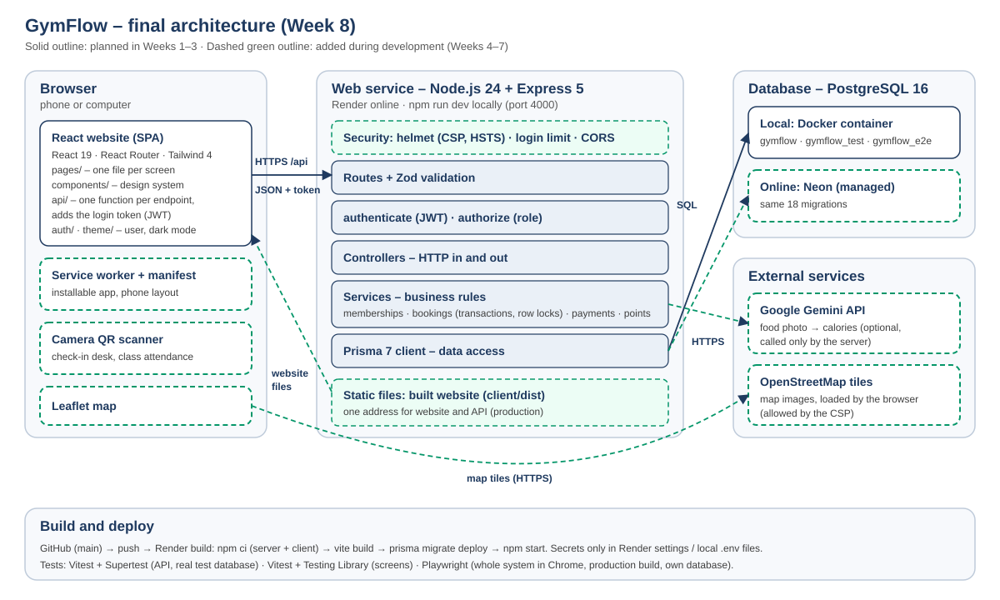

# GymFlow – Final Architecture

*Figure – Final architecture of GymFlow (Week 8). Solid outlines: parts of the original design (Weeks 1–3). Dashed green outlines: parts added during development (Weeks 4–7).*

## How a request travels

A member taps a button in the **React website**. The function for that endpoint in `client/src/api/` sends an HTTP request to `/api/...` with the login token. In the **Express server** the request passes the security layer (security headers, login limit), the route with its **Zod** validation, `authenticate` (is the token valid?) and `authorize` (is this role allowed?), the **controller** (reads the request, sends the response) and the **service**, where the business rules live (for example: a class cannot be booked twice or beyond capacity – checked inside a transaction with row locks). The service reads and writes **PostgreSQL** through the **Prisma** client. The answer travels back the same way and the page shows the result.

## Changes since the original design (Weeks 1–3)

| Original design | Final system | Why it changed |
| --- | --- | --- |
| React app → Express API → PostgreSQL, as separate parts | Same layers; in production **one web service** sends both the website and the API | One address for the browser: no CORS problems online, one free Render service instead of two |
| Database only in Docker | Docker locally, **Neon** online; the same 18 migrations build both | Free managed PostgreSQL for the live demo; migrations keep both identical |
| Routes → controllers → services → Prisma | Unchanged, plus a **security layer** in front (helmet CSP/HSTS, login limit) | Week 6 security review: protection against password guessing and script injection |
| Website for desktop | **Installable app** (service worker, manifest) with a phone layout | Members use GymFlow on their phones at the gym |
| No outside services | **Google Gemini** (food photos, called only by the server) and **OpenStreetMap** tiles (map) | Extensions E5: food scanner and partner-gym map; the Gemini key never reaches the browser |
| Check-in by member number | **Camera QR scanner** for the check-in desk and class attendance | Faster check-in; attendance proves a member was really in the class |

The layered structure inside the server – the core of the original design – did not change. Every new feature (payments, attendance, workouts, nutrition) was added as a new route, controller and service in the same pattern.

See also: [ER diagram](er-diagram.md) (database design, 15 tables).
