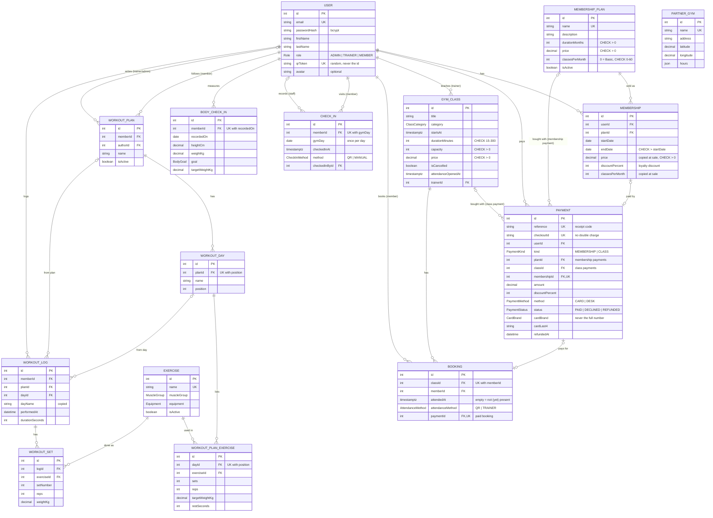

# GymFlow – Entity-Relationship Diagram

The diagrams use [Mermaid](https://mermaid.js.org/) and render automatically on GitHub and in VS Code's Markdown preview.
The source of truth is [`server/prisma/schema.prisma`](../../server/prisma/schema.prisma); database rules that Prisma cannot express (CHECK constraints) are in the hand-written migrations.

## Current schema (after Week 5)

15 tables. Week 5 added `CHECK_IN`, `BODY_CHECK_IN`, `PARTNER_GYM`, `EXERCISE`, `WORKOUT_PLAN`, `WORKOUT_DAY`, `WORKOUT_PLAN_EXERCISE`, `WORKOUT_LOG`, `WORKOUT_SET` and `PAYMENT`, and new columns on `USER`, `MEMBERSHIP_PLAN`, `MEMBERSHIP`, `GYM_CLASS` and `BOOKING`.

## Tables

`createdAt` / `updatedAt` timestamps are left out below; most tables have them.

### User

| Column | Type | Rules |
| --- | --- | --- |
| `id` | integer | primary key, auto-increment |
| `email` | text | required, **unique** (enforced by a database index) |
| `passwordHash` | text | required; bcrypt hash (cost 10) |
| `firstName`, `lastName` | text | required, 1–50 characters |
| `role` | enum `Role` | `ADMIN`, `TRAINER` or `MEMBER`; default `MEMBER` |
| `qrToken` | text | **unique**, random UUID made by the database; the content of the member's QR code; can be reset |
| `avatar` | text | optional id of a chosen avatar; empty = initials |

### MembershipPlan

| Column | Type | Rules |
| --- | --- | --- |
| `name` | text | required, unique (the API also compares ignoring letter case) |
| `description` | text | what the plan includes; may be empty |
| `durationMonths` | integer | 1–60 in the API; **database CHECK > 0** |
| `price` | decimal(10,2) | exact money type; **database CHECK > 0** |
| `classesPerMonth` | integer | group classes per membership month: 0 = **Basic** (gym only), e.g. 10 = **Premium**; **database CHECK 0–60** |
| `isActive` | boolean | inactive plans cannot be sold but stay in the history |

### Membership

| Column | Type | Rules |
| --- | --- | --- |
| `userId` | integer | foreign key → User (`CASCADE`); indexed |
| `planId` | integer | foreign key → MembershipPlan; a plan that was sold cannot be deleted (`RESTRICT`) |
| `startDate`, `endDate` | date | both inclusive; **database CHECK endDate > startDate** |
| `price` | decimal(10,2) | copied from the plan when sold (after the loyalty discount); **database CHECK > 0** |
| `discountPercent` | integer | loyalty discount given on this sale (0, 5, 10 or 15) |
| `classesPerMonth` | integer | copied from the plan when sold, so editing the plan later does not change it |

The membership **status** (active, expiring soon, expired, upcoming, none) is **not stored**: it is calculated from the dates and "today" in the gym's time zone. The **class balance** is not stored either: it is counted from the bookings in the current membership month (which starts on the same day of the month as the membership).

### Payment

| Column | Type | Rules |
| --- | --- | --- |
| `reference` | text | **unique** receipt code, e.g. `GF-7K2Q9X` |
| `checkoutId` | text | **unique**, made by the checkout page once; a double click can never charge twice |
| `userId` | integer | foreign key → User (`CASCADE`); indexed |
| `kind` | enum `PaymentKind` | `MEMBERSHIP` or `CLASS`; **database CHECK: a membership payment always has a `planId`** |
| `planId` | integer | foreign key → MembershipPlan (`RESTRICT`); membership payments |
| `classId` | integer | foreign key → GymClass (`SET NULL`); class payments; stays after a refund |
| `membershipId` | integer | foreign key → Membership (`SET NULL`), **unique**; empty for declined attempts |
| `amount` | decimal(10,2) | amount charged after the loyalty or Premium discount |
| `discountPercent` | integer | discount included in `amount` |
| `method` | enum `PaymentMethod` | `CARD` (online) or `DESK` (front desk) |
| `status` | enum `PaymentStatus` | `PAID`, `DECLINED` or `REFUNDED` |
| `cardBrand`, `cardLast4` | enum, text | only brand and last 4 digits; the full number and CVC are **never stored** |
| `declineReason` | text | shown to the member for declined cards |
| `refundedAt` | timestamptz | when a paid class booking was cancelled and refunded |

### GymClass

| Column | Type | Rules |
| --- | --- | --- |
| `title`, `description`, `location` | text | required; description 20–2000 characters (API) |
| `category` | enum `ClassCategory` | RUNNING, YOGA, HIIT, CYCLING, PILATES, BOXING, STRENGTH, MOBILITY |
| `startsAt` | timestamptz | an exact moment; must be in the future when created (API); indexed |
| `durationMinutes` | integer | **database CHECK 15–300** |
| `capacity` | integer | **database CHECK > 0**; cannot be lowered below existing bookings (API) |
| `level`, `intensity` | enums | `ClassLevel`, `ClassIntensity` |
| `whatToBring`, `healthNotes` | text | optional |
| `price` | decimal(10,2) | price of one class for members who pay per class; default 200; **database CHECK > 0** |
| `isCancelled` | boolean | a class with bookings is cancelled, never deleted; paid bookings are refunded |
| `attendanceOpenedAt` | timestamptz | when the trainer first opened the attendance QR; only then can members miss the class |
| `trainerId` | integer | foreign key → User (`RESTRICT`); indexed |

### Booking

| Column | Type | Rules |
| --- | --- | --- |
| `classId` | integer | foreign key → GymClass (`CASCADE`) |
| `memberId` | integer | foreign key → User (`CASCADE`); indexed |
| — | — | **unique (classId, memberId)**: no double bookings |
| `attendedAt` | timestamptz | set by scanning the trainer's QR or by the trainer; empty after a class with attendance = missed (−10 points) |
| `attendanceMethod` | enum `AttendanceMethod` | `QR` or `TRAINER` |
| `paymentId` | integer | foreign key → Payment (`SET NULL`), **unique**; set for paid bookings, which do not use the monthly included classes |

### CheckIn

| Column | Type | Rules |
| --- | --- | --- |
| `memberId` | integer | foreign key → User (`CASCADE`) |
| `gymDay` | date | the day in the gym's time zone; **unique (memberId, gymDay)**: one check-in (and 10 points) per day; indexed |
| `checkedInAt` | timestamptz | exact moment |
| `method` | enum `CheckInMethod` | `QR` (scanned) or `MANUAL` (member number typed) |
| `checkedInById` | integer | foreign key → User, the staff member (`SET NULL`) |

Loyalty points are **not stored**: they are calculated from check-ins and missed classes (10 per visit, −10 per missed class, never below 0).

### BodyCheckIn

| Column | Type | Rules |
| --- | --- | --- |
| `memberId` | integer | foreign key → User (`CASCADE`) |
| `recordedOn` | date | **unique (memberId, recordedOn)**: a second update on the same day replaces the first |
| `heightCm`, `weightKg`, `targetWeightKg` | decimal(4,1) | target weight optional; ranges checked by the API |
| `goal` | enum `BodyGoal` | LOSE_WEIGHT, BUILD_MUSCLE, GET_FIT, IMPROVE_ENDURANCE, STAY_HEALTHY |

### PartnerGym

| Column | Type | Rules |
| --- | --- | --- |
| `name` | text | **unique** |
| `address`, `district`, `phone` | text | phone optional |
| `latitude`, `longitude` | decimal(8,6) / (9,6) | position on the map (about 10 cm precision) |
| `hours` | json | opening hours per weekday; a missing day means closed (validated by the API) |

### Exercise

| Column | Type | Rules |
| --- | --- | --- |
| `name` | text | **unique** |
| `muscleGroup` | enum `MuscleGroup` | CHEST, BACK, LEGS, SHOULDERS, ARMS, CORE, FULL_BODY, CARDIO |
| `equipment` | enum `Equipment` | BARBELL, DUMBBELL, MACHINE, CABLE, KETTLEBELL, BODYWEIGHT, BAND, CARDIO_MACHINE |
| `description` | text | how to do it |
| `isActive` | boolean | exercises are deactivated, never deleted, so plans and logs keep them |

### WorkoutPlan, WorkoutDay, WorkoutPlanExercise

| Table | Column | Rules |
| --- | --- | --- |
| WorkoutPlan | `memberId` | foreign key → User, the member (`CASCADE`); indexed |
| WorkoutPlan | `authorId` | foreign key → User, the trainer/admin who wrote it (`SET NULL`); only they or an admin may change it |
| WorkoutPlan | `name`, `notes`, `isActive` | plans are switched off instead of deleted |
| WorkoutDay | `planId`, `name`, `position` | **unique (planId, position)**; deleted with the plan (`CASCADE`) |
| WorkoutPlanExercise | `dayId`, `exerciseId`, `position` | **unique (dayId, position)**; an exercise in use cannot be deleted |
| WorkoutPlanExercise | `sets`, `reps`, `targetWeightKg`, `restSeconds`, `notes` | weight empty for bodyweight exercises |

### WorkoutLog, WorkoutSet

| Table | Column | Rules |
| --- | --- | --- |
| WorkoutLog | `memberId` | foreign key → User (`CASCADE`); index on (memberId, performedAt) |
| WorkoutLog | `planId`, `dayId` | foreign keys (`SET NULL`): the history stays when a plan is changed |
| WorkoutLog | `dayName` | copied, so old workouts stay readable |
| WorkoutLog | `performedAt`, `durationSeconds`, `notes` | |
| WorkoutSet | `logId` | foreign key → WorkoutLog (`CASCADE`) |
| WorkoutSet | `exerciseId`, `setNumber`, `reps`, `weightKg` | indexed by exercise for the progress charts and personal bests |

## How the business rules map to the design

| Business rule | Where it is enforced |
| --- | --- |
| Membership end date is after its start date | Date calculation (unit-tested) + database CHECK ✅ |
| Prices, capacities and plan durations are positive | Zod validation + database CHECK ✅ |
| Memberships of one member do not overlap | Service check inside a transaction with a row lock ✅ |
| A member cannot book the same class twice | Unique index on `(classId, memberId)` + service check ✅ |
| A class cannot be booked beyond capacity | Service check inside a transaction with a row lock on the class ✅ |
| A member cannot book a class that has already started | Service check against the current time ✅ |
| Only members with a valid membership on the class day can book | Service check in the gym's time zone ✅ |
| Members without a valid membership cannot check in | Service check in the gym's time zone ✅ |
| Points are earned at most once per day | Unique index on `(memberId, gymDay)` ✅ |
| Basic members get no included classes; Premium at most `classesPerMonth` per membership month | Service check inside the booking transaction, with a row lock on the member ✅ |
| A membership payment always names its plan | Database CHECK ✅ |
| The same checkout is never charged twice | Unique `checkoutId` + service check ✅ |
| A member is never charged for a class they cannot get | All booking rules are checked before the card is charged, in one transaction ✅ |
| Card numbers are never stored | Only `cardBrand` and `cardLast4` columns exist ✅ |
| Trainers only change plans they wrote | Service check on `WORKOUT_PLAN.authorId` (admins may change all) ✅ |
