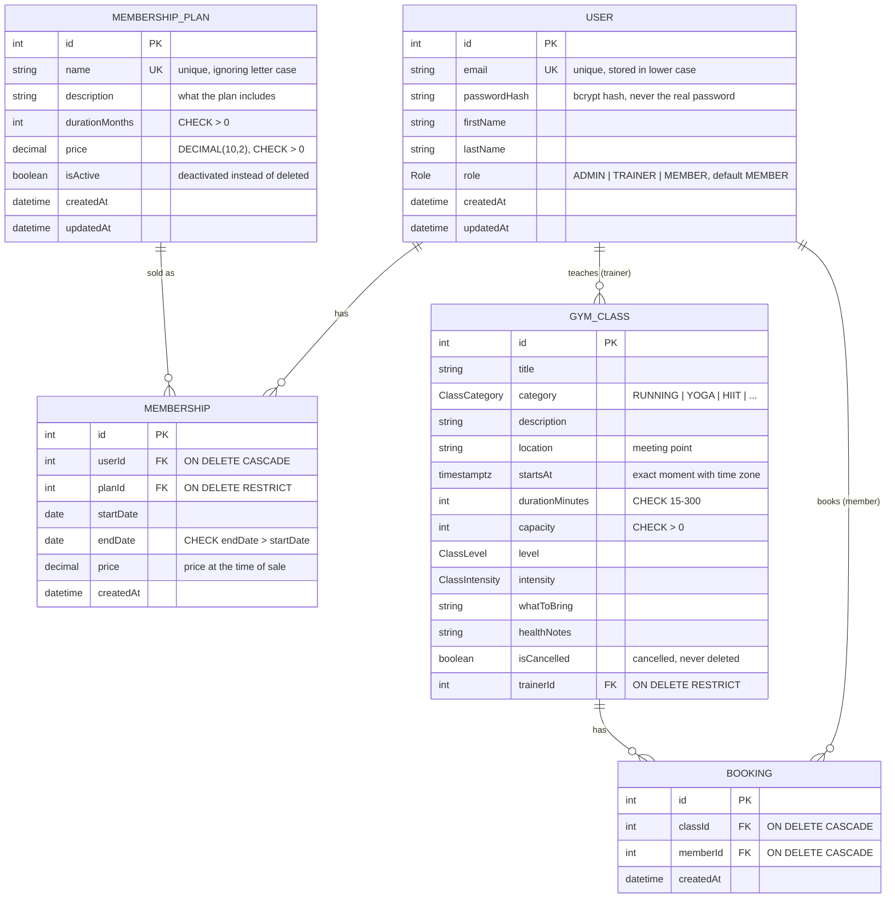
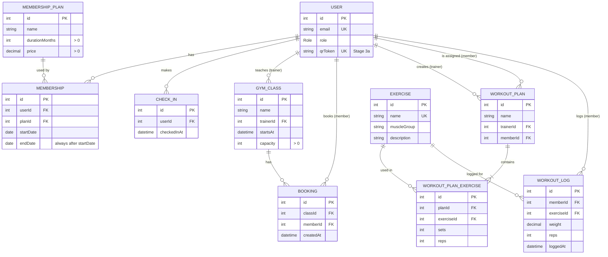

# GymFlow – Entity-Relationship Diagram

The diagrams use [Mermaid](https://mermaid.js.org/) and render automatically on GitHub and in VS Code's Markdown preview.

## Current schema (after Stage 3b)

`BOOKING` has a **unique index on (classId, memberId)**: the database itself makes it impossible to book the same class twice.

### User

| Column | Type | Rules |
| --- | --- | --- |
| `id` | integer | primary key, auto-increment |
| `email` | text | required, **unique** (enforced by a database index) |
| `passwordHash` | text | required; bcrypt hash (cost 10) |
| `firstName`, `lastName` | text | required, 1–50 characters |
| `role` | enum `Role` | `ADMIN`, `TRAINER` or `MEMBER`; default `MEMBER` |
| `createdAt` | timestamp | set automatically on insert |
| `updatedAt` | timestamp | updated automatically on every change |

### MembershipPlan

| Column | Type | Rules |
| --- | --- | --- |
| `id` | integer | primary key |
| `name` | text | required, unique (the API also compares ignoring letter case) |
| `durationMonths` | integer | 1–60 in the API; **database CHECK > 0** |
| `price` | decimal(10,2) | exact money type; at most 2 decimals; **database CHECK > 0** |
| `isActive` | boolean | default `true`; inactive plans cannot be sold but stay in the history |

### Membership

| Column | Type | Rules |
| --- | --- | --- |
| `id` | integer | primary key |
| `userId` | integer | foreign key → User; deleting a user deletes their memberships (`CASCADE`); indexed |
| `planId` | integer | foreign key → MembershipPlan; a plan that was sold cannot be deleted (`RESTRICT`) |
| `startDate`, `endDate` | date | calendar dates without time, both inclusive; **database CHECK endDate > startDate** |
| `price` | decimal(10,2) | copied from the plan when sold; **database CHECK > 0** |

The membership **status** (active, expiring soon, expired, upcoming, none) is **not stored**: it is calculated from the dates and "today" in the gym's time zone, so it is always correct without any scheduled job.

### GymClass

| Column | Type | Rules |
| --- | --- | --- |
| `title`, `description`, `location` | text | required; description 20–2000 characters (API) |
| `category` | enum `ClassCategory` | RUNNING, YOGA, HIIT, CYCLING, PILATES, BOXING, STRENGTH, MOBILITY |
| `startsAt` | timestamptz | an exact moment; must be in the future when created (API) |
| `durationMinutes` | integer | **database CHECK 15–300** |
| `capacity` | integer | **database CHECK > 0**; cannot be lowered below existing bookings (API) |
| `level` | enum `ClassLevel` | BEGINNER, INTERMEDIATE, ADVANCED, ALL_LEVELS |
| `intensity` | enum `ClassIntensity` | LOW, MEDIUM, HIGH |
| `whatToBring`, `healthNotes` | text | optional (default empty) |
| `isCancelled` | boolean | a class with bookings is cancelled, never deleted |
| `trainerId` | integer | foreign key → User (a trainer); a trainer with classes cannot be deleted (`RESTRICT`); indexed |

### Booking

| Column | Type | Rules |
| --- | --- | --- |
| `classId` | integer | foreign key → GymClass (`CASCADE`) |
| `memberId` | integer | foreign key → User (`CASCADE`); indexed |
| — | — | **unique (classId, memberId)**: no double bookings |

## Planned data model (Stages 2–3)

> This is the **planned** design. Each table is added in its own migration in the stage that needs it, and details may change during implementation. `MEMBERSHIP_PLAN`, `MEMBERSHIP`, `GYM_CLASS` and `BOOKING` are already implemented (see above).

### How the business rules map to the design

| Business rule | Where it is enforced |
| --- | --- |
| Membership end date is after its start date | Date calculation (unit-tested) + database check constraint ✅ |
| Prices and capacities are positive | Zod validation + database check constraint ✅ |
| Memberships of one member do not overlap | Service check inside a transaction with a row lock ✅ |
| A member cannot book the same class twice | Unique index on `(classId, memberId)` + service check ✅ |
| A class cannot be booked beyond capacity | Service check inside a transaction with a row lock on the class ✅ |
| A member cannot book a class that has already started | Service check against the current time ✅ |
| Only members with a valid membership on the class day can book | Service check in the gym's time zone ✅ |
| Trainers only see members assigned to them | Through `WORKOUT_PLAN.trainerId` / `memberId` |
