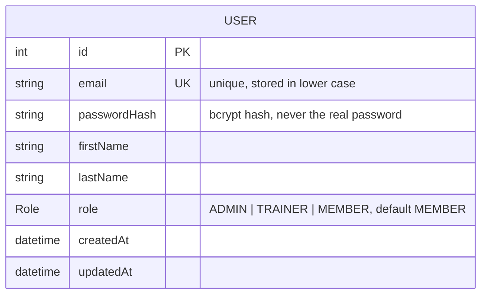

# GymFlow – Entity-Relationship Diagram

The diagrams use [Mermaid](https://mermaid.js.org/) and render automatically on GitHub and in VS Code's Markdown preview.

## Current schema (after Stage 1)

| Column | Type | Rules |
| --- | --- | --- |
| `id` | integer | primary key, auto-increment |
| `email` | text | required, **unique** (enforced by a database index) |
| `passwordHash` | text | required; bcrypt hash (cost 10) |
| `firstName`, `lastName` | text | required, 1–50 characters |
| `role` | enum `Role` | `ADMIN`, `TRAINER` or `MEMBER`; default `MEMBER` |
| `createdAt` | timestamp | set automatically on insert |
| `updatedAt` | timestamp | updated automatically on every change |

## Planned data model (Stages 2–3)

> This is the **planned** design. Each table is added in its own migration in the stage that needs it, and details may change during implementation.

### How the business rules map to the design

| Business rule | Where it is enforced |
| --- | --- |
| Membership end date is after its start date | Service check + database check constraint |
| Prices and capacities are positive | Zod validation + database check constraint |
| A member cannot book the same class twice | Unique index on `(classId, memberId)` + service check |
| A class cannot be booked beyond capacity | Service check inside a database transaction |
| Trainers only see members assigned to them | Through `WORKOUT_PLAN.trainerId` / `memberId` |
